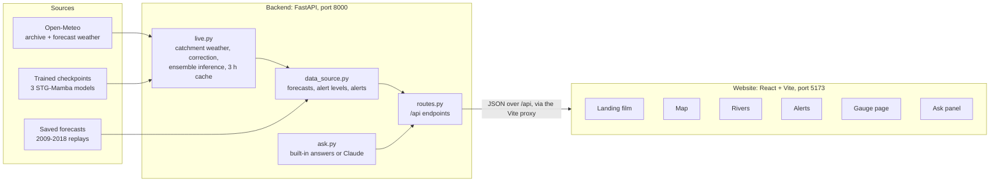
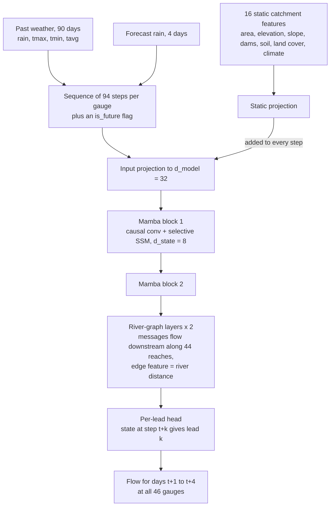

# FloodShield

**AI river flood early warning for India's Godavari and Mahanadi basins.**

FloodShield forecasts daily river flow at 46 gauges four days ahead, using only weather and the shape of the river network. It runs a spatio-temporal graph model with Mamba state-space blocks (STG-Mamba), raises watch and warning levels per gauge, and presents everything in an interactive web platform: a scroll-driven landing film, a live satellite map, a river network view, an alerts feed and a question panel.

> **Research prototype, not an official warning service.** Alert levels mean forecast flow near a gauge's own 95th-percentile flow from 1991 to 2008. They are statistical levels, not Central Water Commission (CWC) danger levels. Nothing is sent to any authority.

---

## Contents

1. [Highlights](#highlights)
2. [Quick start](#quick-start)
3. [System architecture](#system-architecture)
4. [The model: STG-Mamba](#the-model-stg-mamba)
5. [Data](#data)
6. [Training and evaluation](#training-and-evaluation)
7. [Results](#results)
8. [How alerts work](#how-alerts-work)
9. [Live forecasting](#live-forecasting)
10. [The web platform](#the-web-platform)
11. [API reference](#api-reference)
12. [Ask panel](#ask-panel)
13. [Configuration](#configuration)
14. [Repository layout](#repository-layout)
15. [Model development pipeline](#model-development-pipeline)
16. [Testing](#testing)
17. [Troubleshooting](#troubleshooting)
18. [Limitations](#limitations)
19. [Roadmap](#roadmap)
20. [Credits and data sources](#credits-and-data-sources)

---

## Highlights

- **Weather-driven.** The model never sees observed river flow as input, so it can forecast where gauges report late or not at all.
- **Network-aware.** 46 gauges are linked by 44 upstream-to-downstream river reaches. A graph layer passes information downstream, so a rising tributary informs the gauges below it.
- **Small and fast.** About 41,000 parameters per model. The three-model ensemble forecasts all 46 gauges in about 0.3 seconds on a laptop CPU.
- **Honestly scored.** Held-back test years 2013 to 2018 were scored once: about **74% of flood days caught**, **38% of alerts false** and **median NSE 0.62** at lead days 2 to 4, against 30%, 81% and 0.13 for a seasonal-average baseline.
- **Live.** The trained model runs on today's weather from Open-Meteo every 3 hours, and a Past mode replays real floods beside what the rivers actually did.

---

## Quick start

### Requirements

| Tool | Version | Used for |
|---|---|---|
| Python | 3.11 or newer (developed on 3.11 and 3.12) | Backend, model, training |
| Node.js | 20 or newer (developed on 22) | Website |
| Git | any recent | |

A GPU is not needed. Training used an Apple M4 Pro (MPS); serving and live forecasts run on CPU.

### Install

```bash
git clone https://github.com/abhiraj-arya2006/FloodShield.git
cd FloodShield
pip install -r requirements.txt
npm --prefix app/frontend install
```

### Add the trained model

The trained weights and saved forecasts are large, so they are not in git. Put the three checkpoints in `checkpoints/` and import the saved forecasts from the training bundle:

```bash
# --bundle holds outputs/ and checkpoints/ from training; --model-repo is a checkout of the model repository
python scripts/import_model_predictions.py --bundle <folder> --model-repo <folder>
```

This writes `app/backend/data/replay_predictions.parquet` and the real gauges, river links and alert levels. It refuses to write anything unless the forecasts reproduce `metrics/final_test_results.csv` exactly.

### Run

From the project folder:

```bash
npm run dev
```

This starts the backend on port 8000, waits until it answers, then starts the website. Open **http://localhost:5173**. `Ctrl+C` stops both.

To run them separately, use `npm run backend` and `npm run site`. API documentation is at http://127.0.0.1:8000/docs.

---

## System architecture



**Request flow.** When the site opens it calls `/api/live`. The backend returns the current live run, or runs the model if the last run is more than 3 hours old or from an earlier day. Each page then asks for `/api/forecast?date=D&lead=k`. Dates covered by the live run are answered from it; dates from 2009 to 2018 come from the saved replays. A failed refresh keeps serving the last good run, marked stale.

**Date convention.** In the API, `date` is the day being forecast. Day k of a forecast made on day S is `date = S + k` at `lead = k`.

---

## The model: STG-Mamba

STG-Mamba combines a **Mamba encoder** (a selective state-space model that reads each gauge's weather history) with **river-graph layers** (message passing along the river network) and a **per-lead head** that outputs flow for each of the next four days.



| Part | Setting | Where |
|---|---|---|
| Input window | 90 past days + 4 future days | `configs/model.yaml` |
| Dynamic inputs | `prcp`, `tmax`, `tmin`, `tavg` (rain log1p-transformed) | `configs/model.yaml` |
| Static inputs | 16 catchment attributes, none derived from streamflow | `configs/model.yaml` |
| Hidden size | `d_model` 32, SSM state 8, expand 2, conv kernel 4 | `configs/model.yaml` |
| Temporal blocks | 2 Mamba blocks, weights shared across gauges | `src/floodshield/models/mamba_block.py` |
| Graph | 2 layers, downstream direction, distance scale 100 km | `src/floodshield/models/layers.py` |
| Decoder | `per_lead`: lead k sees rain only up to day t+k | `src/floodshield/models/stg_mamba.py` |
| Output | log1p flow, standardised per gauge | `configs/model.yaml` |
| Size | about 41,000 parameters per model | checkpoints |

**Design choices.**

- **No observed flow as input.** `forward()` takes only weather and static features, so streamflow cannot leak into predictions, and the model works where gauge data is missing or late.
- **Pure PyTorch.** The Mamba scan and graph layers are written in plain PyTorch, with no CUDA kernels or torch-geometric, so the model runs on Apple MPS and on any CPU.
- **Ensemble.** The served forecast (`ens_perlead_hf5`) averages three models trained with different seeds, in standardised flow space, as in evaluation.
- **High-flow weighting.** "hf5" means days above the gauge's warning level count five times as much in the training loss, which pushes the model to get floods right rather than ordinary days.

More detail: [`docs/model_architecture.md`](docs/model_architecture.md).

---

## Data

| Dataset | Role | Licence |
|---|---|---|
| [CAMELS-IND v2.2](https://doi.org/10.5281/zenodo.14999580) (Mangukiya et al., 2025) | Daily streamflow, catchment-mean IMD weather, gauge locations, catchment attributes and polygons | CC BY 4.0 |
| [HydroRIVERS v1.0](https://www.hydrosheds.org/products/hydrorivers) | River network used to link gauges upstream to downstream | HydroSHEDS licence, attribution required |
| [Open-Meteo](https://open-meteo.com) | Archive and forecast weather for live forecasts | CC BY 4.0 |
| NASA Blue Marble and Black Marble | Earth imagery in the landing film | NASA Visible Earth |

**Gauges.** 46 gauges with enough streamflow data: 27 on the Godavari and 19 on the Mahanadi (`configs/selected_gauges.csv`). They are linked by 44 directed river reaches with river distances in km (`configs/graph_edges.csv`).

**Splits.** Time-based, so no future data leaks into training:

| Split | Years | Use |
|---|---|---|
| Train | 1991 to 2008 | Fitting the model, normalisers and alert levels |
| Validation | 2009 to 2012 | Early stopping, ensemble choice, alert margin |
| Test | 2013 to 2018 | Scored once, locked by `src/floodshield/evaluation/once_lock.py` |

The split was chosen after looking at data coverage (most streamflow records end in early 2019, and many Godavari gauges have a 2014 to 2015 gap). That is stated alongside the test results.

More detail: [`docs/dataset_sources.md`](docs/dataset_sources.md).

---

## Training and evaluation

- **Loss.** Masked loss on standardised log1p flow: days with missing observations contribute nothing, and missing targets are never filled in. Flood days are weighted five times.
- **Optimiser.** Learning rate 0.001, weight decay 0.0001, batch size 32, up to 60 epochs, with early stopping after 8 epochs without validation improvement.
- **Future rain in training.** The four forecast days use **recorded** IMD rain as a stand-in for a rain forecast. This makes the scores optimistic compared with real forecasting.
- **Metrics.** Median Nash-Sutcliffe efficiency (NSE) and Kling-Gupta efficiency (KGE) across gauges, plus flood-day hit rate and false-alarm share pooled over gauges and days with observed flow.

---

## Results

Held-back test years 2013 to 2018, all 46 gauges, scored once (`metrics/final_test_results.csv`).

| Lead day | Model NSE | Flood days caught | Alerts false | Seasonal average: NSE / caught / false | Same as yesterday: NSE / caught / false |
|---|---|---|---|---|---|
| 2 | **0.62** | **74%** | **38%** | 0.13 / 30% / 81% | 0.00 / 59% / 49% |
| 3 | **0.62** | **75%** | **38%** | 0.13 / 30% / 81% | -0.26 / 51% / 56% |
| 4 | **0.62** | **74%** | **38%** | 0.13 / 30% / 81% | -0.29 / 46% / 60% |

- There were 4,105 observed flood days across the test years.
- Skill barely drops from lead 2 to lead 4, while "same as yesterday" falls fast.
- On the validation years (2009 to 2012) it caught about 80% with 39% false (`configs/alert_margin_final.yaml`).
- Two of the 46 gauges score below zero NSE on the test years.

**XGBoost correction (Phase 3) was tested and left off.** On 2012 it improved everyday error (NSE 0.54 to 0.62 at lead 2) but caught about 100 fewer flood days at each lead and under-predicted peaks further (`metrics/xgb_residual_2012_summary.md`).

---

## How alerts work

```
WARNING  if forecast flow >= q95 x (1 - alert_margin)
WATCH    if forecast flow >= q90 x (1 - alert_margin), below the warning level
NORMAL   otherwise
```

- `q90` and `q95` are each gauge's 90th and 95th percentile flows over the training years 1991 to 2008.
- `alert_margin` is 0.10, so a warning fires at 90% of q95. It was set low on purpose to catch more floods.
- A **flood day**, for scoring, means observed flow above q95.
- The model is daily, so it gives the day a level is crossed, never the hour.

Settings: `configs/river_alert_policy.yaml` (margin), `configs/app_flow_thresholds.csv` (levels the site uses) and `configs/flow_thresholds.csv` (levels the training pipeline uses; same values).

---

## Live forecasting

`app/backend/live.py` runs the trained ensemble on current weather:

1. **Weather.** Daily rain and temperature at 67 sample points on a 1-degree grid covering every catchment, from Open-Meteo. The archive supplies older days (cached once a day), and the forecast service supplies the last 25 days and the next 4.
2. **Catchment means.** Points are averaged over each gauge's real catchment polygon.
3. **Correction.** Open-Meteo rain is mapped toward the IMD rain the model trained on with a per-gauge quantile map, and temperatures are shifted by a per-gauge offset (`app/backend/data/model/weather_correction.json`, fitted on 2010 only).
4. **Inference.** The saved normalisers scale the inputs, the three models run, and their average becomes flow in m³/s.
5. **Cache.** The run is saved to `outputs/live_cache/latest.json` and refreshed every 3 hours. If a refresh fails, the last good run is served as stale.

**Live skill is lower than the published scores**, because the weather is not the IMD data the model trained on. Measured on 2012, using Open-Meteo's archive and a correction fitted only on 2010, lead days 2 to 4:

| Weather | Flood days caught | Alerts false | Median NSE |
|---|---|---|---|
| IMD (as trained) | 81% | 44% | 0.47 |
| Open-Meteo, corrected (live) | 69% | 56% | 0.32 |

This used recorded weather, so real forecast rain will score lower still. Live forecasts have no river readings to check against.

**Reproducibility check.** `scripts/validate_live_pipeline.py` runs the live code on the original training weather and compares it with the saved forecasts: the median relative difference is below one in a million. `scripts/fit_weather_correction.py` refits the correction. Both need the CAMELS-IND zip.

---

## The web platform

React 19, TypeScript, Vite, zustand, GSAP with ScrollTrigger, Locomotive Scroll, three.js, d3-geo and WebGL shaders, in English and Hindi.

| Page | Path | What it shows |
|---|---|---|
| Landing film | `/` | A scroll-driven story: an underwater view up through a fish shoal (instanced three.js fish, water ripples, light caustics, bubbles), rain over the river, a dive, and a NASA-textured Earth turning to India and falling onto the two river networks |
| Map | `/dashboard` | Satellite map of all 46 gauges coloured by level, four-day tabs with real dates, play, zoom, basin filter, search, the gauges closest to their levels on quiet days, and a **real-flood replay** that sets warnings beside what the rivers actually did |
| Rivers | `/river` | Both networks drawn to scale by river distance; rivers swell as forecast flow nears each gauge's high-flow level |
| Alerts | `/alerts` | Watch and warning gauges for the chosen day, with drafted advisory text |
| Gauge | `/gauge/:id` | Four-day forecast chart against the gauge's watch and warning levels, plus its upstream and downstream gauges |
| How it works | `/model-info` | The method, test scores and live skill table in plain language |

**Live and Past.** The site opens on Live (today's run). Past switches to the 2009 to 2018 replays, where the Map offers two real floods, **Sep 2014** and **Jul 2013**. Each plays day by day with a scorecard of warnings that came true, false alerts and missed floods.

**What If.** A stress test that scales the forecast to show how close each gauge is to its levels. It does not re-run the model.

---

## API reference

Base URL `http://127.0.0.1:8000`. Interactive docs at `/docs`.

| Method | Path | Returns |
|---|---|---|
| GET | `/api/health` | Status and mode |
| GET | `/api/gauges` | 46 gauges with location, basin, q90, q95, watch and warning levels |
| GET | `/api/edges` | 44 river links, upstream to downstream, with distance |
| GET | `/api/dates` | Dates available in the replay archive |
| GET | `/api/live` | The current live run: `made_on`, `generated_at`, `stale`, `weather` |
| GET | `/api/forecast?date=YYYY-MM-DD&lead=1..4` | Every gauge's forecast and level for that day and lead |
| GET | `/api/alerts?date=YYYY-MM-DD&lead=1..4` | Watch and warning gauges with drafted advisories |
| GET | `/api/gauges/{id}/forecast?date=YYYY-MM-DD` | One gauge, leads 1 to 4 (replay dates) |
| GET | `/api/model-info` | Model description and data sources |
| POST | `/api/ask` | Streams an answer about the forecast on screen |

Example:

```bash
curl "http://127.0.0.1:8000/api/forecast?date=2014-09-22&lead=4"
```

---

## Ask panel

The **Ask** button answers questions about the forecast on screen, such as "Which gauges are on warning?", "Why is Polavaram flagged?" or "How accurate is this?".

- **Without an API key,** common questions get built-in answers worked out directly from the data.
- **With an Anthropic API key,** open-ended questions are answered by Claude from the same forecast data. Copy `.env.example` to `.env`, set `ANTHROPIC_API_KEY`, and restart the backend.

Each answer says which of the two produced it. The key stays on the server, and questions are limited to 20 a minute per client. The panel gives no safety instructions and points anyone facing a real flood to the CWC and local authorities.

---

## Configuration

| File | Controls |
|---|---|
| `configs/model.yaml` | Model inputs, sizes, graph and decoder |
| `configs/training.yaml` | Splits, normalisation, loss, optimiser, early stopping |
| `configs/data.yaml` | Dataset sources, versions and checksums |
| `configs/river_alert_policy.yaml` | Alert margin. Keep `data_mode: replay`: live forecasts are served by `/api/live`, and the older `live` mode is a stub that returns 501 |
| `configs/alert_margin_final.yaml` | How the 0.10 margin was chosen, with validation results |
| `configs/app_flow_thresholds.csv` | q90 and q95 per gauge, used by the site |
| `configs/flow_thresholds.csv` | q90, q95 and q99 per gauge, used by training |
| `configs/selected_gauges.csv`, `configs/graph_edges.csv` | The 46 gauges and 44 river links |
| `configs/model_info.yaml` | Text for the How it works page |
| `.env` (from `.env.example`) | Data and checkpoint folders, MPS fallback, optional `ANTHROPIC_API_KEY` |

---

## Repository layout

```
FloodShield/
├── app/
│   ├── backend/            FastAPI server
│   │   ├── main.py         App, CORS, startup warm-up of the live forecast
│   │   ├── routes.py       /api endpoints
│   │   ├── data_source.py  Forecasts, alert levels and alerts
│   │   ├── live.py         Live weather, correction and ensemble inference
│   │   ├── ask.py          Ask panel answers
│   │   └── data/           Gauges, edges, model normalisers, catchment points
│   └── frontend/           React + Vite website (src/pages, src/platform, public/textures)
├── src/floodshield/        Model package: data, graph, models, training, evaluation, inference, correction
├── scripts/                Data download, gauge selection, graph build, training, evaluation,
│                           final test, alert margin sweep, XGBoost, import and live validation
├── configs/                YAML configs, gauge list, river links, alert levels
├── metrics/                Training, validation and final test results
├── tests/                  Model, data, leakage, API, live and Ask tests
├── docs/                   Dataset sources, model architecture, live data options, demo plan
├── notebooks/              Data exploration
├── checkpoints/            Trained weights (not in git)
├── data/, outputs/         Raw and processed data, caches (not in git)
├── backend/, ml/, config/  Earlier XGBoost-baseline service (Phase 1)
└── package.json            npm run dev / backend / site / build / test
```

---

## Model development pipeline

To rebuild the model from raw data:

```bash
python scripts/download_data.py        # CAMELS-IND + HydroRIVERS into data/raw/ (verified, re-runnable)
python scripts/select_gauges.py        # configs/selected_gauges.csv + selection report
python scripts/build_forcing_table.py  # catchment weather for the selected gauges -> data/processed/
python scripts/build_graph.py          # river graph -> data/graph/, configs/graph_edges.csv
python scripts/build_training_data.py  # windows, normalisers, thresholds -> data/processed/training/
python scripts/train.py --decoder per_lead --high-flow-weight 5 --run-name stg_mamba_perlead_hf5
python scripts/evaluate.py             # validation metrics and baselines
python scripts/sweep_alert_margin.py   # alert margin sweep on validation
python scripts/run_final_test.py       # the one-time test on 2013-2018
```

Repeat the training step with `--seed` and a new `--run-name` for each ensemble member. On a Mac, `python -m pip install -e .` installs the `floodshield` package, and `PYTORCH_ENABLE_MPS_FALLBACK=1` (in `.env`) lets unsupported operations fall back to CPU.

---

## Testing

```bash
npm test                              # all Python tests (python -m pytest tests -q)
npm --prefix app/frontend run build   # type-check and build the website
```

155 tests cover the environment, data loading and gauge selection, the river graph, leakage safety, the Mamba block and graph layer, the masked loss, the test-split lock, the alert margin, XGBoost correction, the API, live forecasting with real checkpoints, and the Ask panel. Three are skipped: two need an Apple GPU and one covers an unbuilt part.

---

## Troubleshooting

| What you see | Cause | Fix |
|---|---|---|
| "The forecast service isn't responding" | The website or backend stopped | Run `npm run dev` again in the project folder and refresh |
| The site opens in Past mode with 2013 dates | The page opened before the backend was ready | Refresh once the backend prints `Uvicorn running` |
| `npm run dev` says an older backend is on port 8000 | A backend from another folder is running | Stop it with `Ctrl+C` in its terminal, then run again |
| Port 8000 error `10048` | Something else holds port 8000 | Stop it, or run `npm run site` to reuse a running FloodShield backend |
| `No module named 'app'` | The backend was started from the wrong folder | Start it from the project root |
| `Replay data file missing` | Saved forecasts not imported | Run `scripts/import_model_predictions.py` (see Quick start) |
| `Missing checkpoint` on `/api/live` | Weights not in `checkpoints/` | Copy the three `stg_mamba_perlead_hf5*_best.pt` files there |

---

## Limitations

- **Not official.** Levels are statistical, not CWC danger levels, and no alert is sent anywhere.
- **Optimistic test scores.** Training and testing used recorded rain for the forecast days, and real forecast rain is less accurate.
- **Live weather differs from training weather.** Live skill measured on 2012 is lower (see [Live forecasting](#live-forecasting)), and live forecasts have no river readings to check against.
- **Missed floods.** About one flood day in four is missed on the test years, and about four alerts in ten are false.
- **Daily resolution.** The model gives days, not hours.
- **46 gauges only.** Coverage is limited to gauges with enough CAMELS-IND streamflow data.

---

## Roadmap

1. **IMD live weather** via `imdlib`, the same source the model trained on (`docs/live_data_options.md`).
2. **Training with forecast-like rain errors**, so scores reflect real forecasting.
3. **Live river readings** from CWC to check live forecasts as they happen.
4. **More languages** (Telugu, Odia, Marathi) for people in the two basins.
5. **Alert delivery** (CAP and SMS) to district authorities, only after validation with them.

---

## Credits and data sources

- **Team:** Abhiraj Arya ([@abhiraj-arya2006](https://github.com/abhiraj-arya2006)) and Ayush Dheer. The model training pipeline was merged from [`ayushdheer4-del/floodshield`](https://github.com/ayushdheer4-del/floodshield).
- **CAMELS-IND:** Mangukiya, N. K. et al. (2025), *Earth System Science Data* 17, 461-491, doi:10.5194/essd-17-461-2025. Data: doi:10.5281/zenodo.14999580 (CC BY 4.0).
- **HydroRIVERS:** Lehner, B. and Grill, G. (2013), HydroSHEDS.
- **Weather data** by [Open-Meteo.com](https://open-meteo.com) (CC BY 4.0). The free API is for non-commercial use.
- **Earth imagery:** NASA Visible Earth.
- **Mamba:** Gu, A. and Dao, T. (2023), *Mamba: Linear-Time Sequence Modeling with Selective State Spaces*.

No licence has been chosen for this code yet.
